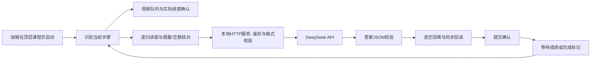

# 项目设计、知识点与技术路线

## 1. 先从一次完整任务理解系统

这个项目有两条同时相关、但职责不同的路线。浏览器脚本负责课程页面；Node.js 服务负责模型请求。油猴只是脚本的安装和启动载体，不负责生成答案。



一次章节测验会经历：识别页面 → 等待题目与提交按钮 → 核对题量及编辑器 → 分批请求 → 校验所有答案 → 选择或填写 → 回读 → 提交 → 等待完成 → 下一节。各阶段的状态写入 `app._quizState`，页面状态框通过只读接口展示这些状态。

## 2. 为什么采用“浏览器脚本 + 本地服务”

浏览器天然可以读当前已登录课程的 DOM、操作播放器、触发页面事件，因此适合承担页面交互。它不适合把长期 API Key 直接放在可分享的脚本中。

Node.js 服务只监听 `127.0.0.1:37841`，接收网页整理出的题目，校验后转发给 DeepSeek。API Key 从启动窗口输入，只存在进程内存中；停止服务后再次启动，需要重新输入。脚本携带的是每次启动生成的临时连接令牌，不是 DeepSeek API Key。

这不是“绝对安全”：运行时脚本中仍有临时令牌，网页正文会发往模型，调用还可能计费。设计的作用是分离长期密钥和浏览器交互，并减少误请求；它不能保证机器被完全控制后仍保密。

## 3. 文件如何分工

| 文件 | 职责 |
| --- | --- |
| `xuexitong-console.js` | 唯一的课程流程实现：发现内容、播放、导航、识题、请求与回填 |
| `build-userscript.mjs` | 添加油猴元信息，把启动模式从 console 转为 userscript |
| `xuexitong-deepseek.user.js` | 生成后的油猴入口；服务启动后包含本次临时令牌 |
| `deepseek-local.mjs` | 启动 HTTP 服务、读取密钥、来源与令牌校验、生成两个客户端文件 |
| `deepseek-request.mjs` | 题目格式校验、UTF-8 请求读取、DeepSeek 调用与响应解析 |
| `tests/*.mjs` | 模拟页面、媒体、编辑器、网络响应及启动故障 |

油猴版和控制台版不维护两套答题逻辑。构建函数只添加元信息并改变启动模式，测试还会核对生成文件与源码一致。这减少了“改了一个入口，另一个入口没更新”的漂移。

## 4. 浏览器作用域、DOM 与 iframe

### 4.1 为什么会出现 app 未定义

页面可能有顶层课程框架、卡片 iframe、作业 iframe、UEditor iframe。每个 frame 有自己的 `window` 和全局变量。脚本放在顶层，控制台却选在作业 frame 时，直接输入 `app` 就可能找不到。

跨 frame 只读诊断使用 `window.top.__xuexitongConsoleDeepSeek`。不过这仅在浏览器允许访问时有效。同源取决于协议、主机和端口，不能把所有学习通子域都当成同源。

### 4.2 递归发现内容

`scanCourseContent()` 从顶层开始，按 DOM 顺序遍历视频和 frame，递归收集可访问文档。它会跳过隐藏或无法访问的分支，并单独记录不可访问框架，而不是因一个异常让整个扫描失败。

frame 已经存在不代表它的 body 已经创建。`createTreeWalker()` 只能接收真正的节点，因此读题前必须验证 body 和 `nodeType`，并隔离单个文档的错误。

### 4.3 TreeWalker、Range 与容器边界

TreeWalker 用来逐个遍历文本节点，找到 `【单选题】`、`【填空题】` 等标签。标签可能被多个 span 拆开，不能只假设它完整落在一个文本节点内。

找到类型后向祖先查找题目容器。填空题最多检查 64 层，但遇到含多道题的容器或 BODY/HTML 就停止。找到全部字段后，使用同时包含题型标记与这些字段的最小容器，减少题干、相邻题和页脚混入。

选择题通过 DOM Range 读取首个选项之前的内容作为题干，避免把所有选项再次拼进题干。它比只按文本里的第一个字母 A 切割更可靠，但仍需要具体页面结构配合。

## 5. 播放器处理：请求成功不等于结果成功

`video.play()` 返回 Promise。Promise fulfilled 只表示播放请求被接受，不能证明播放时间已经前进。网页也可能立即再次暂停，或媒体未真正运行。

当前流程优先使用已存在的 Video.js 实例，没有合适实例时才使用原生媒体接口。它会设置静音、滚动到可见区域、发出有超时的请求，再观察非暂停状态和实际时间增量。连续没有进度时限制尝试次数；遇到浏览器 `NotAllowedError`，明确提示需要用户点击。

多个视频用页面顺序组成队列，用 WeakMap 关联视频及其来源的完成状态。WeakMap 的键可以是 DOM 对象，且不会仅因脚本持有映射就永久阻止旧节点被回收。只认一个 `video` 会漏掉同页第二个视频；只认步骤标题又会把“视频 → 视频”误判成没有切换。

## 6. 异步、计时器与状态机

JavaScript 事件和定时器会交错执行：视频结束事件、网页自行替换 iframe、用户点击下一节、定时检查都可能尝试接管流程。缺少互斥时会重复请求答案或重复点击提交。

项目用 `quizBusy`、导航状态、运行编号和停止标记区分当前任务；用独立步骤观察器发现平台自身的页面切换。失败任务在同一页面不会被每秒自动重试，避免持续重复调用 API。`destroy()` 会清理观察器、延迟跳转、播放检测和事件绑定。

这里可学习 Promise/async-await、超时竞争、轮询、事件监听、状态机、幂等和资源清理。轮询不应无限叠加；一个功能停止时，相关计时器也需要停止。

## 7. 四种题型怎样变成统一数据

选择与判断题都归一化为选项字母。判断题内部约定 A=正确、B=错误，再映射回实际 DOM 元素，因此页面把“错误”排在前面也不影响含义。

```json
{"id":1,"type":"单选题","question":"示例题干","options":[{"letter":"A","text":"选项甲"},{"letter":"B","text":"选项乙"}]}
```

填空题保留题干中的空位位置，用 `[第1空]`、`[第2空]` 代替实际输入区域，同时记录空数。不能把多个空的答案简单用逗号切开，因为答案本身也可能包含逗号。

```json
{"id":2,"type":"填空题","question":"前文[第1空]中间[第2空]后文","blank_count":2,"options":[]}
```

模型响应分别使用 `letters` 或 `blanks` 数组。校验包括题号唯一且完整、选项存在、单选只返回一个字母、多选不重复、填空数组长度匹配、内容非空以及字段长度限制。

前端每批 10 题顺序请求；各批题号从 1 开始，再映射回整套题号。全部批次都校验完成后才操作页面。服务端的单批格式上限与前端批大小不同，当前服务允许 1～30 题，前端主动使用 10 题。

## 8. 为什么富文本填空比普通输入框难

普通 input/textarea 的 `value` 不是页面业务状态的全部。程序设值后通常还需要触发 input/change，让网页表单框架感知变化。项目尽量使用原生属性 setter，并派发相应事件。

UEditor 的输入区则在 iframe 的 body 中，下方 textarea 常常是隐藏同步字段。把 iframe 和 textarea 都数成空，会重复计数；只按可见性过滤，又可能漏掉已存在的有效实例。

项目枚举已有的 `UE.instants`，把 body、iframe、题目容器和实例身份对应起来。不会调用猜测 ID 的 `UE.getEditor()` 来探测，因为该方法找不到时可能创建并渲染新编辑器。

写入采用转义后的 HTML 调用 `setContent()`，再 `sync()`；回读时保留换行。对可确认的提交字段还会核对同步内容。填写前和填写后都重新核对实例、字段数量及顺序，任何变化都停止提交。

UEditor 官方源码使用 `isReady = 1`。V4.7.4 错误地只把 `true` 当作隐藏实例已就绪，造成 40/40 已识别却还有 11 空永久等待；V4.7.5 同时接受数字 1 和布尔 true。数字 0、false 和未确认的隐藏实例仍不能直接放行。

## 9. 本地 HTTP、鉴权与数据边界

浏览器到本地服务是跨源 HTTP 请求。服务处理 OPTIONS 预检，并限制允许的学习通来源、请求方法和内容类型；正式请求还必须携带 `X-Xuexitong-Token`。来源检查和随机令牌承担不同作用，不能互相替代。

服务先绑定端口再要求输入 API Key。这样旧进程占用端口时，会在用户输入密钥前明确失败，也不会先改写脚本令牌。新服务启动成功后，才把令牌写入两个客户端文件。

网络数据按字节分块，不保证每个 chunk 刚好落在汉字边界。直接对每块做 UTF-8 字符串拼接可能破坏字符；`StringDecoder` 会保留未完成的多字节序列。当前格式错误返回明确字段和阶段，区别本地校验失败与上游调用失败。

## 10. 如何理解测试证据

`deepseek-flow.mjs` 使用自建模拟 DOM、播放器和模型响应，覆盖正常流程与故障路径；`navigation-keeper.mjs` 检查辅助窗口；`local-service-startup.mjs` 使用临时端口检查启动和版本一致性。当前合计 100 项行为检查。

模拟测试能稳定重现：双视频、即时重新暂停、空 body、判断符号、多批次失败、多空回读、UE 数字就绪标记等。它不能证明真实平台永远兼容。此前模型 fixture 默认用布尔 true，恰好漏掉官方数字 1 的真实情况，说明“测试很多”不等于“假设正确”。

实际测试采用分层证据：页面状态 → 只读结构诊断 → 最小复现 → 回归检查 → 用户再次验证。最终 V4.7.5 获得本次实际课程顺畅运行的反馈，但不应推广成所有课程或所有题型的保证。

## 11. 可以继续学习和改进的方向

- 把巨大的浏览器流程文件逐步拆成媒体、导航、题型适配、编辑器适配和诊断模块，同时保留单文件构建产物。
- 使用明确的适配器接口描述每种编辑器的发现、就绪、读取、写入和同步，不在多个阶段重复猜测。
- 增加脱敏真实 DOM 固定样本，补足纯模拟 fixture 对实际库行为的偏差。
- 将运行时生成文件与受版本控制的模板进一步分离，减少误提交临时令牌的机会。
- 设计“生成建议、人工确认后提交”的可选模式，以及对图片题的明确提示；这些是后续方向，当前版本没有宣称已实现。

## 参考来源

- [UEditor 官方核心实现](https://github.com/fex-team/ueditor/blob/dev-1.5.0/_src/core/Editor.js)：ready、setContent、sync 与数字标记。
- [DeepSeek API 官方文档](https://api-docs.deepseek.com/)：API 入口与模型调用方式；当前项目使用 `deepseek-flash`。
- [Tampermonkey 元信息与 API](https://www.tampermonkey.net/documentation.php)：match、noframes、执行环境。
- [浏览器同源策略](https://developer.mozilla.org/en-US/docs/Web/Security/Defenses/Same-origin_policy)：frame 访问边界。
- [Microsoft Edge 断点说明](https://learn.microsoft.com/en-us/microsoft-edge/devtools/javascript/breakpoints)：debugger 暂停与停用断点。
